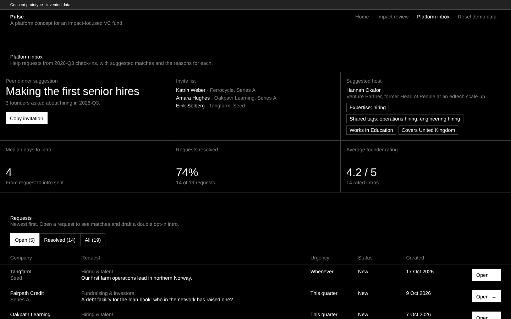

# Pulse

**A quarterly founder check-in. A platform concept for an impact-focused VC fund.**

> Concept prototype by Dennis Schülting · invented data.
> No real portfolio company, person or figure appears in the app.

## What it is

A VC fund's platform team covers two areas: portfolio support (communities, Venture Partners, corporate partners, events) and impact reporting (portfolio impact data, SFDR, EU Taxonomy). Both depend on founders, and both need to scale across the whole portfolio without becoming extra work for founders.

Pulse turns that reporting into one short quarterly check-in with two outputs.

1. The founder confirms or updates only the fields due this quarter, pre-filled from last time.
2. Then they answer one question: *What would help most this quarter?*

The **impact numbers** go to an impact review queue and a portfolio view computed as in the EIF Gamma Model. The **help requests** go to a platform inbox. It suggests the best Venture Partner, corporate partner or portfolio peer for each request and says why. When three or more founders ask about the same thing, it suggests a peer dinner with an invite list and a host.

**One check-in, two answers, and less founder time.**

## Approach

- **Each field at its real cadence.** Impact KPIs are asked every quarter. The annual adverse-impact (PAI) fields wait for the Q4 check-in, which covers the calendar year like the SFDR reference period, and they are pre-filled from last year. In the demo, Hearthline's Q3 check-in asks about 3 fields, and 20 annual fields wait for Q4.
- **Data quality is the product.** Every value has a definition, a unit, a period, an estimate flag and an evidence note. Large jumps need a note. The impact team accepts or queries each value, and every change goes into an append-only audit log.
- **The platform is measured by outcomes.** Intros are double opt-in drafts, capacity-aware, and closed with a founder rating. The inbox reports days to intro, share resolved and average rating, not activity.

### How the rules work

Every rule sits in [`src/lib/config.ts`](src/lib/config.ts).

| Rule | In short | Code |
|---|---|---|
| **Cadence** | Impact KPIs every quarter. Annual PAI fields only in the Q4 check-in, which is filed after year-end and covers the calendar year, like the PAI reference period. | `src/lib/cadence.ts` |
| **Pre-fill** | Every field starts from its last value. The check-in records how many fields were shown, pre-filled and changed. | `cadence.ts` |
| **Validation** | zod checks type, unit and sign: no negatives except a pay gap; whole numbers for counts; yes/no for booleans. | `src/lib/schema.ts` |
| **Plausibility** | A change of more than ±50% from last period, or any fall in a cumulative KPI, needs a note before submit. | `src/lib/plausibility.ts` |
| **In-year status** | progress = (value − last year-end) ÷ (this year's target − last year-end), against expected = quarter/4. On track ≥ expected − 0.10; at risk ≥ expected − 0.25; otherwise off track. This is Pulse's early warning; the annual measure is the portfolio aggregate below. | `src/lib/status.ts` |
| **Portfolio aggregate** | "Impact achieved vs target", computed as in the EIF Gamma Model: actual ÷ target per KPI, weighted within the company, then weighted by invested capital, **one figure per fund**. Uncapped, so a fund can exceed 100%. | `src/lib/aggregate.ts` |
| **Matching** | 3·category + 1·shared tags (max 2) + 2·sector + 1·market + 2·past success − 1·load. Helpers at capacity are left out; ties go by name. Every scoring term becomes a reason chip. Peers: companies that solved the same category with a rating ≥ 4, preferring one stage ahead and the same sector. | `src/lib/match.ts` |
| **Peer dinner** | Three or more companies with open requests in one category this quarter. The host is the best-scoring Venture Partner. | `match.ts` |
| **Something else** | A ninth request option for needs outside the eight categories. It goes to the Platform team to triage, with no peers or dinner; its count shows which category is missing. | `match.ts` |
| **Adverse-impact fields** | Exact RTS wording (Delegated Regulation (EU) 2022/1288, Annex I), extracted by script from EUR-Lex into `research/pai_table1.json`, and tested. | `src/data/pai.ts` |

## Result



*The platform inbox at 1440 px. All companies, people and figures are invented.*

A 60-second demo video is in [`public/pulse-demo.mp4`](public/pulse-demo.mp4); the end-to-end test records it. The demo path:

1. **Start check-in** for Hearthline. Set heat pumps to **700**: the badge goes from at risk to on track.
2. Set CO2e to **1,900**: a plausibility prompt asks for a note. Add one.
3. Ask for **Hiring & talent**: "Hiring our first US sales lead", this quarter. Submit.
4. **Impact review**: the jump is flagged with its note. Accept it.
5. **Platform inbox**: the request is on top, with matches, reasons and intro drafts. The peer dinner card lists 4 founders.
6. **Export CSV.**

Checked by:

- 108 unit tests in 11 files (Vitest) on hand-computed fixtures, including one that recomputes the portfolio figures from the exported CSV alone and one that checks every adverse-impact field against the RTS wording.
- 17 end-to-end tests (Playwright): axe-core with no serious or critical issues on every route and in the dialogs, no horizontal scroll at 390 px, and the demo above as one test.

## Tech stack

- **App:** React 18 and TypeScript 5, built with Vite 6. React Router 6 with hash routing, so the build is a static site with no server rules.
- **Styling:** Tailwind CSS 3 (PostCSS, Autoprefixer). Design tokens live in `design/tokens.json`; `npm run theme` writes them to `src/styles/tokens.css`. Typeface: Arimo via `@fontsource/arimo`.
- **Charts and validation:** Recharts 3 for the sparklines, zod 3 for value validation.
- **State:** a React reducer persisted to `localStorage`. No backend.
- **One-file build:** `vite-plugin-singlefile` (`npm run build:single`).
- **Tests:** Vitest 3 for unit tests; Playwright 1.63 with `@axe-core/playwright` for the end-to-end and accessibility tests.
- **Source script:** Python 3 in `research/` rebuilds `research/pai_table1.json` from the EUR-Lex text of the RTS.

## How to run

Needs Node.js 20+.

```bash
npm ci               # install the locked dependencies
npm run dev          # dev server at http://localhost:5173
npm test             # unit tests (Vitest)
npm run typecheck    # TypeScript
npm run build        # static site in dist/
npm run e2e          # end-to-end and axe tests against the production build (Playwright, Chromium)
```

- `npm run e2e` needs a Playwright Chromium (`npx playwright install chromium` once).
- `npm run build:single` writes `dist-single/pulse.html`, one file that opens by double-click and works offline.
- `npm run demo` re-records `public/pulse-demo.mp4` (needs ffmpeg).
- Routes: `/` · `/#/check-in/<company>` · `/#/impact` · `/#/platform`
- **Reset demo data** in the header restores the starting point. State stays in your browser (`localStorage`, key `pulse-demo-v3`); nothing is sent anywhere.
- To deploy, upload the contents of `dist/` to any static host. Routing uses the URL hash, so no server rules are needed. Every page carries `noindex, nofollow`; `robots.txt` allows crawling so that crawlers can read that tag.
- To rebuild the RTS transcription, save the EUR-Lex text of Delegated Regulation (EU) 2022/1288 as plain text and run `python3 -I research/build_pai_table1.py <rts.txt> research/pai_table1.json`.

## License

The source code is released under the [MIT License](LICENSE), © 2026 Dennis Schülting.

All companies, founders, helpers and figures in the app are invented. `research/pai_table1.json` and the field labels built from it quote Delegated Regulation (EU) 2022/1288 from EUR-Lex, © European Union. The Arimo typeface (SIL Open Font License 1.1) and the npm dependencies come under their own licenses.
